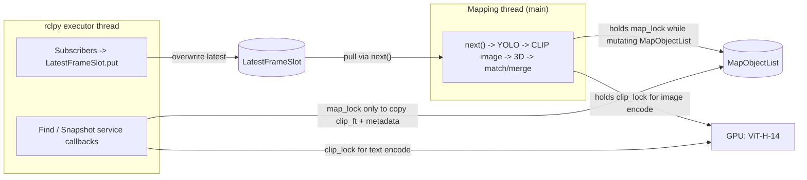

# Dataflow and model usage

End-to-end view of the online mapper (`online_scene_graph/slam/online_mapping.py`). Three neural models run on the hot path: one instance segmenter (`detector:`, default `yoloe_pf`, optionally re-masked by `masker:`), OpenCLIP ViT-H-14 and, when `use_dino: true`, a DINOv2 ViT-B/14. Everything after that is geometry (depth back-projection, DBSCAN, voxel downsample, IoU/overlap).

> Note: **SAM 3 is not used in this repo.** The default segmenter is YOLOE prompt-free (`yoloe_pf`), whose own instance masks are used directly. MobileSAM (`mobile_sam.pt`) is used only in the two-stage `yolo11_sam` backend or when `masker: mobile_sam` is set; `masker: fastsam` uses FastSAM instead. On 8 Replica frames YOLOE-pf boxes + MobileSAM masks looked cleaner at edges than YOLOE's own masks but cost ~45 ms more per frame and did not score better on a depth-leak proxy, so SAM is not on the default path.

## 1. System dataflow

```mermaid
flowchart TD
    subgraph SRC["Camera publishers (sources/) — or the robot itself"]
        REP["replica_publisher.py<br/>(dataset replay, GT pose)"]
        R3D["record3d_publisher.py<br/>(phone, ARKit pose)"]
        HSR["HSR robot<br/>(camera + VSLAM)"]
    end

    REP & R3D & HSR -->|"4 ROS topics: rgb, depth,<br/>camera_info, pose (T_wc)"| ROSIN

    subgraph INGEST["Ingest — slam/ros_frame_source.py, frame_ipc.py"]
        ROSIN["message_filters sync<br/>(ApproxTime, slop 0.1s)"]
        SLOT["LatestFrameSlot<br/>(drop-oldest, keep-last 1)"]
        ROSIN --> SLOT
    end

    SLOT -->|"Frame: rgb, depth, K, pose"| DET

    subgraph PERFRAME["Per-frame loop (mapping thread) — online_mapping.py"]
        DET["<b>2D detection + instance masks</b><br/>utils/detector_backends.py<br/>MODEL: YOLOE-PF (default) | YOLOE | YOLO26-seg | YOLO11 + MobileSAM<br/>optional masker: MobileSAM | FastSAM replaces the detector's masks"]
        CLIPIMG["<b>Per-detection embeddings</b><br/>utils/model_utils.py<br/>CLIP: OpenCLIP ViT-H-14 (laion2b) image tower -> clip_ft<br/>DINO: DINOv2 ViT-B/14 CLS (use_dino) -> dino_ft<br/>same crop for both (padded bbox, or masked if clip_mask_crop)"]
        FILT["Filter detections<br/>(mask area, conf, bbox ratio, bg classes)<br/>mask_subtract_contained"]
        subgraph BP["Back-project masked depth to 3D — slam/utils.py"]
            direction LR
            ERODE["Erode mask<br/>mask_erode_px"] --> UNPROJ["Unproject masked depth<br/>(K + pose) -> per-object pcd"]
            UNPROJ --> VOX["Voxel downsample 2.5 cm"]
            VOX --> SOR["Statistical outlier removal<br/>outlier_nb_neighbors, outlier_std_ratio"]
            SOR --> DBS["DBSCAN: keep largest cluster"]
            DBS --> BBOX["Bounding box"]
        end
        DL["DetectionList<br/>(pcd, bbox, clip_ft, dino_ft, class, conf)"]
        MATCH["Data association — slam/mapping.py<br/>spatial sim (overlap/IoU) + visual sim<br/>(1-w)*cos(clip_ft) + w*cos(dino_ft) -> sim_sum > 1.2"]
        MERGE["Merge matched / append new<br/>merge_obj2_into_obj1:<br/>fuse pcd, running-mean clip_ft + dino_ft,<br/>majority-vote class_name"]
        POST["Periodic post-process<br/>denoise (DBSCAN) / filter / merge overlaps<br/>(uses spatial + clip_ft + text-sim thresholds)"]
        DET --> CLIPIMG --> FILT --> ERODE
        BBOX --> DL
        DL --> MATCH --> MERGE --> POST
    end

    MAP[("MapObjectList<br/>per object: uuid, class_name, clip_ft, dino_ft,<br/>pcd, bbox, num_detections")]
    POST --> MAP
    MATCH <-.->|"reads clip_ft + pcd"| MAP

    subgraph SERVE["Query serving — slam/grounding.py, find_ros.py"]
        LOCK{{"map_lock / clip_lock<br/>generation counter"}}
        CLIPTXT["<b>Text query embedding</b><br/>MODEL: same OpenCLIP ViT-H-14<br/>text tower (shared weights with mapper)"]
        FIND["find(): copy clip_ft + metadata under map_lock,<br/>cosine(query, objects), min_sim / min_obs, top-k"]
        SNAP["snapshot(): points + colors per object<br/>(npz bytes, generation-gated)"]
        LOCK --- FIND
        LOCK --- SNAP
        CLIPTXT --> FIND
    end
    MAP -->|"set_objects() bumps generation"| LOCK

    CLI["scripts/find_query.py<br/>ros2 service call"] -->|"srv Find(text,k,min_sim,min_obs)"| CLIPTXT
    FIND -->|"json hits: id, class, sim, center, aabb"| CLI
    VIZ["scripts/viz_query.py<br/>(Open3D GUI)"] -->|"srv Snapshot"| SNAP
    VIZ -->|"srv Find"| CLIPTXT

    MAP --> OUT["On exit (Ctrl+C -> y)<br/>outputs/online/exps/online/<br/>pcd_*.pkl.gz + objects/edges json"]
    MAP -.-> RR["Rerun viewer<br/>images every rerun_image_interval frames;<br/>map (pcd x3 + boxes) as static data every rerun_objects_interval frames"]
    PLAN["PDDL planner bridge<br/>(not built yet — see online-graph-pddl-architecture.md)"] -.-> SNAP
```

## 2. Where each model runs

| Stage | Model / algorithm | Code | Input -> output | Config |
| --- | --- | --- | --- | --- |
| Instance masks (default) | **YOLOE-26m-seg-pf**, prompt-free, built-in vocabulary of 4,585 tags (checked on `yoloe-26m-seg-pf.pt`; includes non-object tags such as "action film"); native masks. The bg-class label filter rarely matches these names | `detector_backends.py` | BGR frame -> boxes, conf, class ids, masks | `detector: yoloe_pf`, `yoloe_pf_weights`, `detection_conf` |
| Instance masks (alt) | **YOLOE-26l-seg**, open vocab, text prompts from `yoloe_classes.txt` (24 classes: the 8 grocery categories, furniture, floor; set by `classes_file` in `classes.yaml`) | `detector_backends.py` | frame -> boxes, masks | `detector: yoloe` |
| Instance masks (alt) | **YOLO26s-seg**, native instance seg, closed vocab (COCO) | `detector_backends.py` | frame -> boxes, conf, class ids, masks | `detector: yolo26_seg` |
| Instance masks (alt) | **YOLO11l** boxes + **MobileSAM** masks (box-prompted, two-stage) | `detector_backends.py` | frame -> boxes -> SAM masks | `detector: yolo11_sam` |
| Mask refinement (optional) | **MobileSAM** (box prompt) or **FastSAM** (box-matched mask); replaces the detector's masks | `detector_backends.masks_for_boxes` | boxes -> masks (a box FastSAM skips falls back to the detector's mask) | `masker: none \| mobile_sam \| fastsam` |
| Per-object semantic feature | **OpenCLIP ViT-H-14** (`laion2b_s32b_b79k`), image encoder, L2-normalized | `model_utils.compute_clip_features_batched` | crops (batched) -> `clip_ft` (1024-d) | `clip_mask_crop`, `clip_crop_padding` |
| Per-object instance feature | **DINOv2 ViT-B/14** (`vit_base_patch14_dinov2.lvd142m`, timm), CLS token, L2-normalized | `model_utils.compute_dino_features` | the same crops, squashed to 224x224 -> `dino_ft` (768-d) | `use_dino`, `dino_model`, `dino_img_size`, `dino_weight` |
| Query embedding | Same **ViT-H-14** text encoder (CLIP only; DINO has no text tower) | `grounding.GroundingService.encode_text` | text -> unit vector | shares `clip_model` and `clip_lock` with the mapper |
| Data association | `(1-w)*cos(clip_ft) + w*cos(dino_ft)` + 3D overlap/IoU | `slam/mapping.py` | M detections x N objects -> match indices | `sim_threshold`, `dino_weight`, `spatial_sim_type`, `match_method` |
| Object fusion | Running-mean `clip_ft` and `dino_ft` (weights = `num_detections`, renormalised), point-cloud union. The merged object keeps the `id` (and `inst_color`) of the side created first (smaller `curr_obj_num`), whichever side is the target, so an object keeps one id for the run | `slam/utils.merge_obj2_into_obj1` | matched pair -> one object | `downsample_voxel_size`, `dbscan_*` |

### Why both CLIP and DINO

CLIP gives the semantic feature used for text queries and DINO gives an instance-level appearance feature used for matching. [Liu et al., *Data or Language Supervision: What Makes CLIP Better than DINO?* (arXiv 2510.11835)](https://arxiv.org/abs/2510.11835), a VLM-encoder study, trains CLIP and DINO under matched conditions and finds that CLIP "captures high-level semantics (e.g., object categories, text)" while DINO is "more sensitive to low-level cues like color schemes, and is more invariant to orientation change" (its summary: CLIP is more semantically meaningful, DINO emphasises visual similarity). The two also disagree on many image pairs, so each carries information the other lacks. That motivates CLIP for `find()` and a DINO term for telling visually distinct instances of one category apart. The paper tests neither association nor mapping and reports no hybrid experiments, so the 0.5 `dino_weight` and the gain on this system are untested; compare object count against ground-truth instances with `use_dino` on and off.

With `clip_mask_crop: false` (the current default) neither model sees a mask: both get the padded bbox crop. Set it to `true` for a masked, square-padded crop shared by both.

The detector's class label never affects association or merging; it is used by the background / large-box filters, the majority-vote `class_name`, and what `find()` returns. The per-detection `text_feats` path is commented out in `compute_clip_features_batched`, so `merge_text_sim_thresh` has no text feature to compare against.

### Not on the hot path

- **GPT-4V / LLaVA** (`utils/vlm.py`, `make_edges`) is off by default (`make_edges: false`). It was for spatial relations and is legacy from ConceptGraphs. The code is still imported by `general_utils.py`, so `openai` must be installed.
- **VSLAM** is not in this repo. Poses come in on the `pose` topic.

## 3. Threads and locks

Query threads copy features out under `map_lock` and score the copy, so a concurrent merge cannot leak deleted ids. The `generation` counter lets clients detect a stale result.

## 4. Typical cost split

CLIP image encoding scales with detections per frame (one ViT-H crop each, ~20 ms each in fp32 on an RTX 3090), so a detector that returns more boxes makes the loop slower. DINOv2 ViT-B/14 at 224 px adds one more (cheaper) forward per crop when `use_dino` is on. YOLOE-pf alone returned 3-21 detections per Replica frame at `conf` 0.25 (detector ~30 ms). See [`online-graph-pddl-architecture.md`](online-graph-pddl-architecture.md) for the bottleneck analysis and [`ros-ingest.md`](ros-ingest.md) for the topic and QoS contract.
