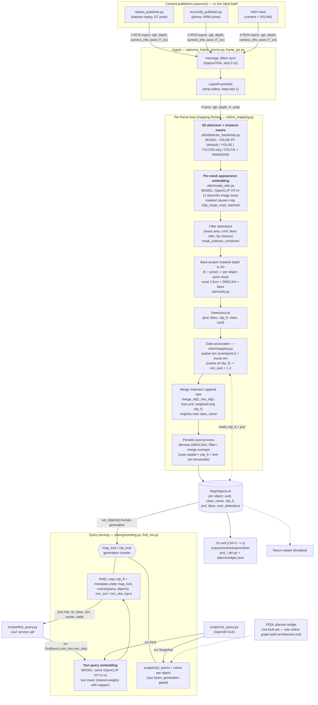
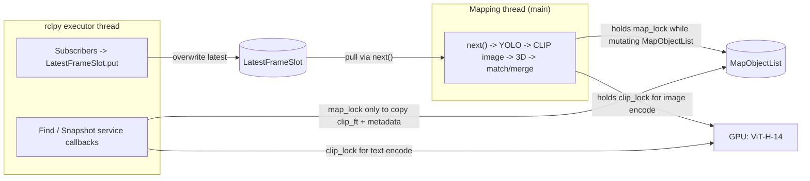

# Dataflow and model usage

End-to-end view of the online mapper (`online_scene_graph/slam/online_mapping.py`). Only **two** neural models run on the hot path: one instance segmenter (chosen by `detector:`, default `yoloe_pf`) and one CLIP ViT. Everything after that is geometry (depth back-projection, DBSCAN, voxel downsample, IoU/overlap).

> Note: **SAM 3 is not used in this repo.** The default segmenter is YOLOE prompt-free (`yoloe_pf`), whose own instance masks are used directly. The only SAM is `mobile_sam.pt` in the two-stage `yolo11_sam` backend (YOLO11 boxes, then box-prompted SAM masks). On 8 Replica frames YOLOE-pf boxes + MobileSAM masks looked cleaner at edges than YOLOE's own masks but cost ~45 ms more per frame and did not score better on a depth-leak proxy, so SAM is not on the default path.

## 1. System dataflow

## 2. Where each model runs

| Stage | Model / algorithm | Code | Input -> output | Config |
| --- | --- | --- | --- | --- |
| Instance masks (default) | **YOLOE-11m-seg-pf**, prompt-free, built-in LVIS/Objects365 vocabulary; native masks | `detector_backends.py` | BGR frame -> boxes, conf, class ids, masks | `detector: yoloe_pf`, `yoloe_pf_weights`, `detection_conf` |
| Instance masks (alt) | **YOLOE-11l-seg**, open vocab, text prompts from `scannet200_classes.txt` | `detector_backends.py` | frame -> boxes, masks | `detector: yoloe` |
| Instance masks (alt) | **YOLO26s-seg**, native instance seg, closed vocab (COCO) | `detector_backends.py` | frame -> boxes, conf, class ids, masks | `detector: yolo26_seg` |
| Instance masks (alt) | **YOLO11l** boxes + **MobileSAM** masks (box-prompted, two-stage) | `detector_backends.py` | frame -> boxes -> SAM masks | `detector: yolo11_sam` |
| Per-object visual feature | **OpenCLIP ViT-H-14** (`laion2b_s32b_b79k`), image encoder, L2-normalized | `model_utils.compute_clip_features_batched` | padded bbox crops (batched) -> `clip_ft` (1024-d) | hard-coded in `online_mapping.py` |
| Query embedding | Same **ViT-H-14** text encoder | `grounding.GroundingService.encode_text` | text -> unit vector | shares `clip_model` and `clip_lock` with the mapper |
| Data association | cosine(`clip_ft`) + 3D overlap/IoU | `slam/mapping.py` | M detections x N objects -> match indices | `sim_threshold`, `spatial_sim_type`, `match_method` |
| Object fusion | Weighted-average `clip_ft`, point-cloud union | `slam/utils.merge_obj2_into_obj1` | matched pair -> one object | `downsample_voxel_size`, `dbscan_*` |

The detector's class label never affects association or merging; it is used by the background / large-box filters, the majority-vote `class_name`, and what `find()` returns. The per-detection `text_feats` path is commented out in `compute_clip_features_batched`, so `merge_text_sim_thresh` has no text feature to compare against.

### Not on the hot path

- **GPT-4V / LLaVA** (`utils/vlm.py`, `make_edges`) is off by default (`make_edges: false`). It was for spatial relations and is legacy from ConceptGraphs. The code is still imported by `general_utils.py`, so `openai` must be installed.
- **VSLAM** is not in this repo. Poses come in on the `pose` topic.

## 3. Threads and locks

Query threads copy features out under `map_lock` and score the copy, so a concurrent merge cannot leak deleted ids. The `generation` counter lets clients detect a stale result.

## 4. Typical cost split

CLIP image encoding scales with detections per frame (one ViT-H crop each, ~20 ms each in fp32 on an RTX 3090), so a detector that returns more boxes makes the loop slower. YOLOE-pf alone returned 3-21 detections per Replica frame at `conf` 0.25 (detector ~30 ms). See [`online-graph-pddl-architecture.md`](online-graph-pddl-architecture.md) for the bottleneck analysis and [`ros-ingest.md`](ros-ingest.md) for the topic and QoS contract.
